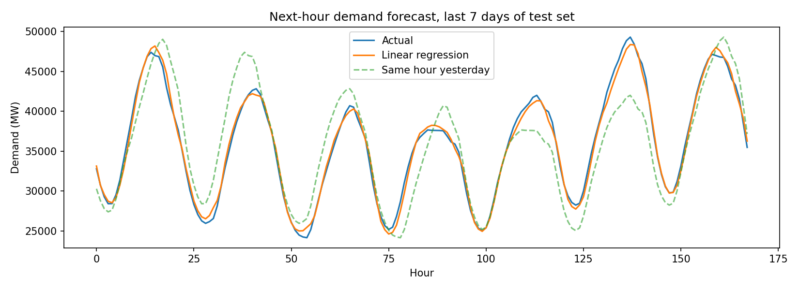

# Power Systems & Machine Learning Portfolio

Three small projects built while learning MATLAB, power systems fundamentals and PyTorch. They cover electricity demand forecasting (Python), network modelling (MATLAB) and power factor correction (MATLAB).

**Author:** Mudassir Moin, B.Eng. Electrical Engineering, The Hong Kong Polytechnic University

| Project | Language | Folder |
|---|---|---|
| [Short-term electricity demand forecasting](#1-short-term-electricity-demand-forecasting) | Python, PyTorch | `forecasting/` |
| [Bus admittance matrix (Ybus) for a 3-bus network](#2-bus-admittance-matrix-ybus) | MATLAB | `ybus/` |
| [Short transmission line and power factor correction](#3-short-transmission-line-and-power-factor-correction) | MATLAB | `transmission_line/` |

---

## 1. Short-term electricity demand forecasting

**Goal:** predict the next hour's electricity demand (MW) from the previous 24 hours.

**Data:** [Hourly Energy Consumption](https://www.kaggle.com/datasets/robikscube/hourly-energy-consumption) (Kaggle), PJM East region (`PJME_hourly.csv`). The dataset is not included here; download it from Kaggle and place it in the `forecasting/` folder.

**Method**
1. Load the series, remove duplicate timestamps and fill missing hours by interpolation (30 hours filled).
2. Build input windows of 24 consecutive hours, with the following hour as the target.
3. Split chronologically: first 80% for training, last 20% for testing. The data is not shuffled, so the model never sees the future.
4. Normalise using training-set statistics only, to avoid leaking information from the test set.
5. Train a linear regression (`nn.Linear(24, 1)`) in PyTorch with MSE loss and the Adam optimiser.
6. Evaluate with Mean Absolute Percentage Error (MAPE) against two naive baselines.

**Results** (145,392 hourly records, held-out test set)

| Method | MAPE |
|---|---|
| Same hour yesterday | 6.93% |
| Previous hour | 3.48% |
| **Linear regression (24-hour window)** | **1.82%** |



**Run it**
```bash
cd forecasting
pip install -r requirements.txt
python3 forecast.py
```

**Limitations:** this is a one-hour-ahead forecast, so the accuracy would be lower for longer horizons. It uses past demand only, with no weather or calendar features.

---

## 2. Bus admittance matrix (Ybus)

**Goal:** build the Ybus matrix of a 3-bus power network from per-unit line impedances, then use it to find nodal currents.

**Method:** convert each line impedance to an admittance (`y = 1/z`). Each off-diagonal entry is `-y` of the line joining the two buses. Each diagonal entry is the sum of the admittances of all lines connected to that bus. Nodal currents follow from `I = Ybus · V`.

**Test network (per unit)**

| Line | Impedance |
|---|---|
| 1–2 | 0.020 + j0.080 |
| 2–3 | 0.010 + j0.040 |
| 1–3 | 0.015 + j0.060 |

**Result**

| | Bus 1 | Bus 2 | Bus 3 |
|---|---|---|---|
| **Bus 1** | 6.863 − j27.451 | −2.941 + j11.765 | −3.922 + j15.686 |
| **Bus 2** | −2.941 + j11.765 | 8.824 − j35.294 | −5.882 + j23.529 |
| **Bus 3** | −3.922 + j15.686 | −5.882 + j23.529 | 9.804 − j39.216 |

**Checks built into the script:** Ybus is symmetric (error 0) and each row sums to zero (about 4e-15), as expected for a network with no shunt elements. The results were also compared with an independent calculation in Python.

**Run it:** open `ybus/build_ybus.m` in MATLAB (or MATLAB Online) and press Run.

---

## 3. Short transmission line and power factor correction

**Goal:** model a short three-phase transmission line feeding an inductive load, and show the effect of power factor correction with a capacitor bank.

**Model:** per-phase short-line model with series impedance only, so `Vs = Vr + I·Z`. Voltage regulation is `(|Vs| − |Vr|) / |Vr|`.

**Assumptions (example values)**

| Parameter | Value |
|---|---|
| Receiving-end voltage | 33 kV line-to-line |
| Load | 10 MW, 0.80 power factor lagging |
| Line impedance | 2 + j6 Ω per phase |
| Frequency | 50 Hz |
| Target power factor | 0.95 |

**Results**

| | Before | After |
|---|---|---|
| Power factor | 0.80 | 0.95 |
| Line current | 218.7 A | 184.2 A |
| Sending voltage | 35.00 kV | 34.24 kV |
| Voltage regulation | 6.05% | 3.76% |
| Line loss | 287.0 kW | 203.5 kW |

The capacitor bank needed is 4.21 MVAr in total (12.3 µF per phase), and line losses fall by 29.1%. The load still draws the same real power; the capacitors supply part of its reactive power locally, so less current flows through the line and the voltage drop and I²R losses both fall.

**Run it:** open `transmission_line/short_line_pf.m` in MATLAB and press Run. Change the parameters at the top of the script to try other cases.

**Possible extension:** build the same model in Simulink / Simscape Electrical and compare the results with this script.

---

## Notes

- These are learning projects. AI tools were used as a coding and explanation aid, and I reviewed and tested the results myself.
- Skills practised: Python (PyTorch, Pandas, NumPy, Matplotlib), MATLAB, complex power, power factor, three-phase systems, per-unit values and nodal analysis.
